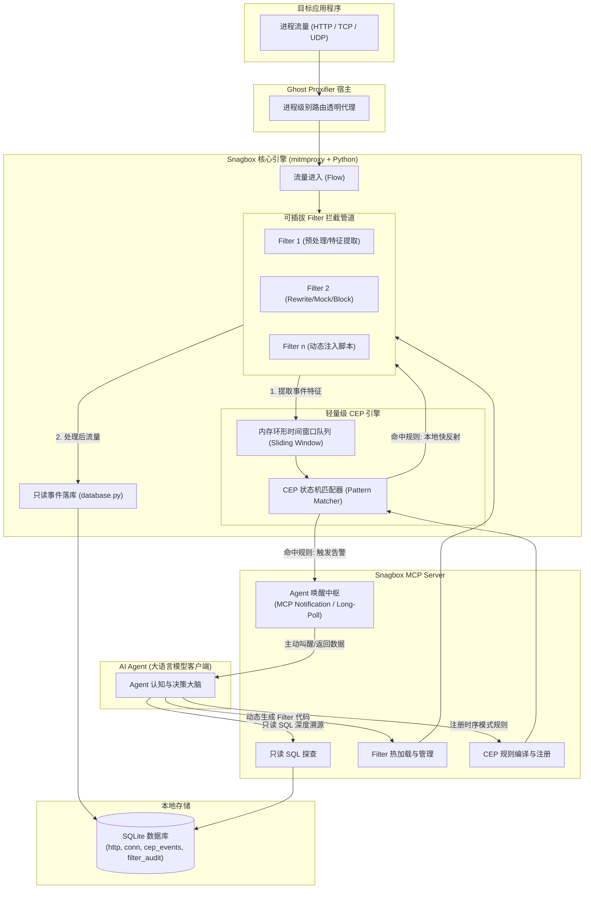
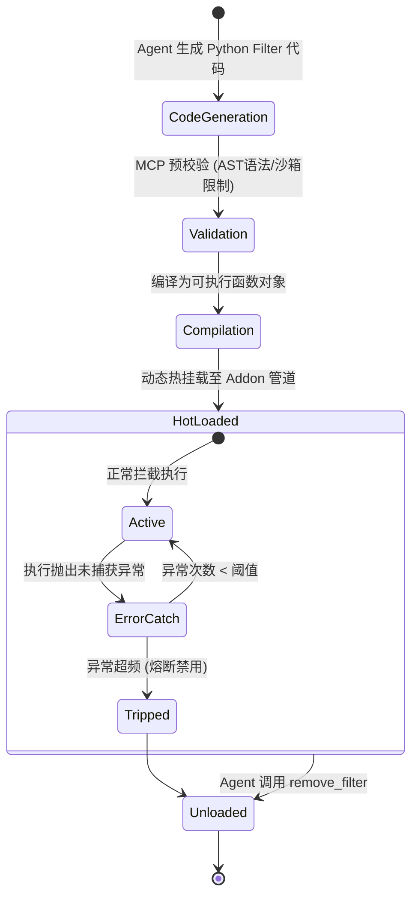
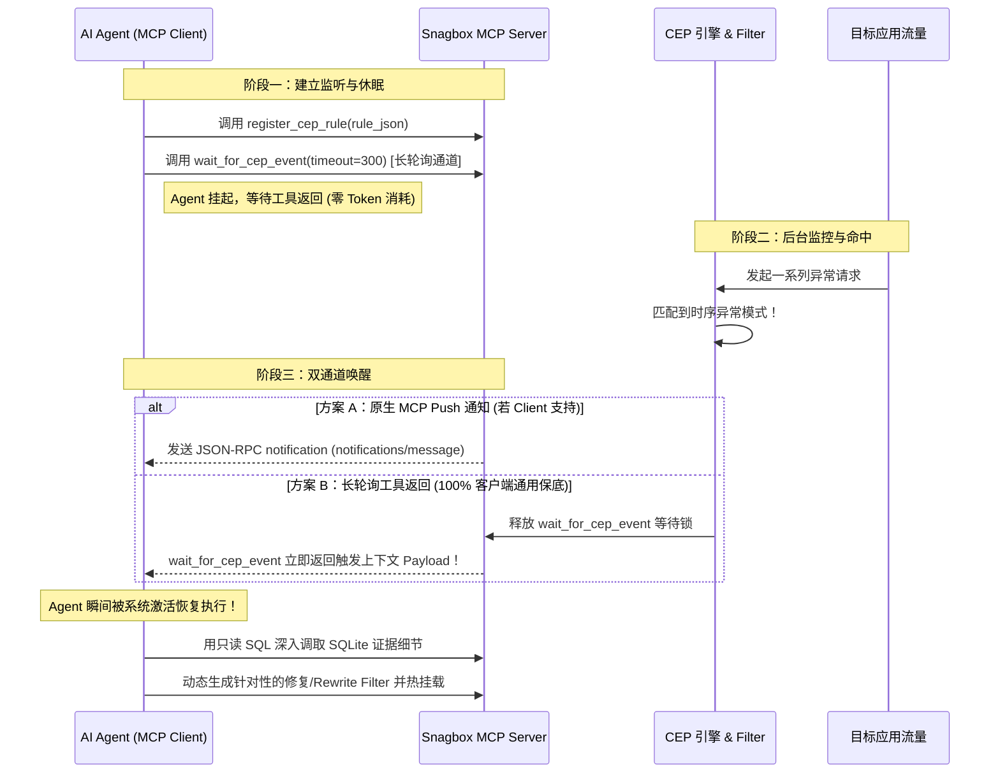

# 茄盒（Snagbox）动态 Filter 与 CEP 机制详细设计文档

**文档版本**：v1.0 (Detailed Architecture & Implementation Spec)  
**设计目标**：将茄盒从“只读离线网络分析器”升级为“具备动态可编程干预（Filter）与流式时序反应感知（CEP）的自愈式网络调试平台”。

---

## 1. 架构总览

在保留原有“流量采集（mitmproxy）+ 本机结构化（SQLite）+ 只读分析（MCP SQL）”的基础上，本设计引入**控制流（Control Plane）**与**流式反应流（Reactive Event Plane）**两大核心子系统。

### 1.1 系统架构图



---

## 2. 可插拔动态 Filter 机制详细设计

### 2.1 核心职责与生命周期
Filter 负责处理**单次请求/连接的微观介入**（Per-Flow Interception）。每个 Filter 均为一段由 Agent 动态生成的轻量 Python 代码片段。



### 2.2 挂载点位（Hook Points）规范
动态 Filter 必须实现一个或多个标准钩子函数：

```python
# 标准 Filter 接口签名
def on_request(flow: HTTPFlow, context: FilterContext) -> FilterAction | None:
    """在请求发送至远端服务器前触发"""
    pass

def on_response(flow: HTTPFlow, context: FilterContext) -> FilterAction | None:
    """在响应返回给客户端前触发"""
    pass

def on_tcp_message(flow: TCPFlow, message: TCPMessage, context: FilterContext) -> FilterAction | None:
    """在收到 TCP 数据块时触发（可用于原始协议分析）"""
    pass
```

### 2.3 支持的四类动作行为（FilterAction）
Filter 通过返回特定 Action 或直接就地修改 flow 来生效：

1. **`REWRITE`（修改重写）**：
   - 请求侧：替换 Query 参数、改写 Headers、修改 JSON 请求体、计算并附加动态签名（Sign）。
   - 响应侧：修改 HTTP 状态码、改写返回 JSON、脱敏或解密混淆数据。
2. **`MOCK`（短路直接响应）**：
   - 不向远端发送真实网络请求，直接在本地构造 `HTTPResponse.make(200, b'{"mock": true}', {"Content-Type": "application/json"})` 返回。
3. **`BLOCK`（物理阻断/丢弃）**：
   - 调用 `flow.kill()` 直接中断连接，用于屏蔽特定广告、埋点追踪或阻断可疑请求。
4. **`TAG`（事件打标与元数据注入）**：
   - 不修改报文本身，但在 `flow.metadata["snagbox_tags"]` 注入自定义标签，该标签会同步写入 SQLite 供 Agent 精确查询。

### 2.4 安全沙箱与防护栅栏（Safety Harness）
为防止 Agent 编写的代码死循环或引发 mitmproxy 崩溃，Filter 运行时执行如下保护：
- **禁用危险内建模块**：通过受限 globals，禁止 `os.system`、`subprocess`、`sys.exit` 等危险调用。
- **单次执行超时**：单次 Hook 执行超过 `20ms` 强制打断并记录警告。
- **异常熔断器（Circuit Breaker）**：如果某个 Filter 连续 3 次抛出未处理异常，自动将其状态置为 `TRIPPED`（禁用），并通过日志和 MCP 通知告警，绝不拖垮整个代理主进程。

---

## 3. CEP（复杂事件处理）机制详细设计

### 3.1 核心概念：从单点到时序模式
CEP 负责处理**跨时间窗口、跨请求事件的相关性分析**。

- **事件（Event）**：由 Filter 或代理日志发出的结构化信号。
- **时间窗口（Window）**：支持滑动时间窗口（如 `last 10s`）与事件数量窗口（如 `last 50 requests`）。
- **模式（Pattern）**：基于布尔谓词、状态机与时间间隔的复合表达式。

### 3.2 声明式 CEP 规则规范（JSON Schema DSL）
Agent 不需要写复杂的底层多线程逻辑，只需通过 MCP 下发声明式的 CEP 规则定义：

```json
{
  "rule_id": "cep_auth_failure_storm",
  "name": "认证失效风暴检测",
  "description": "检测客户端在短时间内连续认证失败且未触发Token刷新",
  "window": {
    "type": "time_sliding",
    "duration_seconds": 10
  },
  "sequence": [
    {
      "step": "s1",
      "filter": "event.type == 'http' && event.status_code == 401",
      "min_occurrences": 3
    },
    {
      "step": "s2",
      "filter": "event.type == 'http' && event.path == '/api/v1/auth/refresh'",
      "quantifier": "NOT_OCCURRED",
      "within_seconds": 5
    }
  ],
  "actions": [
    {
      "type": "notify_agent",
      "severity": "high",
      "message": "检测到目标应用陷入 401 死循环，刷新机制未生效"
    },
    {
      "type": "enable_filter",
      "target_filter_name": "auto_inject_dummy_token"
    }
  ]
}
```

### 3.3 轻量流式引擎内部结构
采用轻量级内存环形队列（Ring Buffer）+ 有限状态机（FSM）模式实现，不依赖外部大型流计算组件：

```text
流量事件入队 (Event Stream)
       │
       ▼
[ RingBuffer: 最近 N 秒事件快照 (保留在 RAM，低开销) ]
       │
       ▼
[ Pattern Matcher: 针对注册的 Active Rules 进行流式评估 ]
       ├── 1. 检查时钟过期并淘汰老旧事件
       ├── 2. 状态机匹配序列（S1 满足 -> 开启计时器观察 S2）
       └── 3. 模式达成条件触发
               │
               ▼
[ Action Dispatcher: 派发执行 ]
       ├── 本地动作：激活指定 Filter / 写入 cep_trigger_log
       └── 异步通知：推入 Agent 唤醒就绪队列 (Wakeup Hub)
```

---

## 4. Agent 唤醒与反向通知体系（Wakeup Hub）

为了彻底解决“服务端检测到了事件，但客户端 AI 处于休眠状态无法被动感知”的痛点，设计了**双通道唤醒架构**：



### 4.1 唤醒 Payload 数据结构
当 CEP 命中唤醒 Agent 时，返回的信息不是简单的纯文本，而是高度压缩的**结构化现场快照**：

```json
{
  "status": "triggered",
  "rule_id": "cep_auth_failure_storm",
  "timestamp": 1731170000,
  "summary": "10秒内连续发生 3 次 401 响应，且无 token 刷新",
  "evidence": {
    "flow_uids": ["u_1001", "u_1003", "u_1007"],
    "time_range": {"start": 1731169992, "end": 1731169999},
    "affected_hosts": ["auth.example.com"],
    "suggested_sql": "SELECT * FROM http WHERE uid IN ('u_1001', 'u_1003', 'u_1007')"
  }
}
```
Agent 拿到这份 Payload 后，无需从海量数据里重新盲查，直接通过 `suggested_sql` 就能直奔案发现场。

---

## 5. 新增 MCP 工具接口规范（Tool Schemas）

在保留原有只读 SQL 和抓包启停工具的基础上，新增如下 7 个控制与反应式工具：

| 工具名 | 参数 | 职责描述 |
|---|---|---|
| `install_filter` | `name: str, code: str, priority: int = 100` | 校验并热挂载一段 Python Filter 代码至拦截流 |
| `list_filters` | 无 | 查看当前所有加载的 Filter 及其运行状态、拦截计数和报错率 |
| `remove_filter` | `name: str` | 卸载指定的 Filter |
| `replay_request` | `uid: str, modifications: dict = None` | 根据数据库中的 `uid` 原样或修改后重新发送一次请求 |
| `register_cep_rule` | `rule_id: str, rule_json: str` | 注册一条声明式 CEP 时序模式匹配规则 |
| `list_cep_rules` | 无 | 查看当前激活的 CEP 规则及其触发命中计数 |
| `wait_for_cep_event`| `timeout_seconds: int = 120` | 挂起等待 CEP 事件触发（用于保底唤醒 Agent） |

---

## 6. 数据库模型扩展（SQLite Schema Extensions）

为支持规则审计、执行留痕与追溯，在 `database.py` 中补充两张新表：

### 6.1 `filter_audit_log`（Filter 操作与熔断日志）
```sql
CREATE TABLE IF NOT EXISTS filter_audit_log (
    id INTEGER PRIMARY KEY AUTOINCREMENT,
    ts REAL NOT NULL,
    filter_name TEXT NOT NULL,
    action TEXT NOT NULL,       -- 'INSTALLED', 'UNLOADED', 'TRIPPED', 'RUNTIME_ERROR'
    code_snapshot TEXT,
    error_message TEXT
);
```

### 6.2 `cep_trigger_log`（CEP 触发事件记录表）
```sql
CREATE TABLE IF NOT EXISTS cep_trigger_log (
    trigger_id TEXT PRIMARY KEY,
    ts REAL NOT NULL,
    rule_id TEXT NOT NULL,
    rule_name TEXT NOT NULL,
    severity TEXT NOT NULL,     -- 'LOW', 'MEDIUM', 'HIGH', 'CRITICAL'
    evidence_uids TEXT NOT NULL,-- JSON 数组格式保存的关联 flow uid 列表
    snapshot_json TEXT NOT NULL
);
```

---

## 7. 实施路线图（Implementation Roadmap）

- **阶段一（动态 Filter 基础与命中可观测性）[✅ 已落地并验证通过]**：
  - 重构 `database.py`，新增 `filter_registry` 与 `filter_hits` 表，实现操作与指标留痕。
  - 重构 `addon.py`，增加 `request` 钩子，实现 `FilterManager`、沙箱执行与连续异常熔断。
  - 在 `mcp_server.py` 实现 `install_filter`、`list_filters`、`remove_filter`、`toggle_filter` 与 `replay_request`。
  - 编写并执行了集成测试 `tests/test_phase1.py`，100% 验证通过 Mock、Rewrite、Diff 审计与熔断机制。
- **阶段二（CEP 模式匹配引擎）[待推进]**：
  - 实现内存轻量级 `SlidingWindowRingBuffer`。
  - 实现基于时序状态机的声明式 JSON CEP 规则解析与匹配器。
  - 在 `mcp_server.py` 提供 `register_cep_rule` 与 `list_cep_rules`。
- **阶段三（双通道唤醒与闭环）[待推进]**：
  - 实现 `wait_for_cep_event` 挂起阻塞工具与 MCP Notification 推送机制。
  - 编写端到端自动化测试用例（时序异常检测 -> 唤醒 Agent -> 自动改包验证闭环）。
